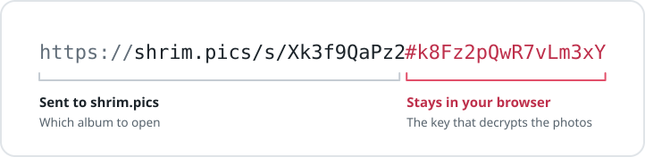

<p align="center">
  <a href="https://shrim.pics">
    <picture>
      <source media="(prefers-color-scheme: dark)" srcset=".github/assets/logo-dark.svg">
      
    </picture>
  </a>
</p>

<h1 align="center">shrim.pics</h1>

<p align="center">
  Share an Immich album with a link.<br>
  Friends see the photos. They never see your server, and we can't see your photos.
</p>

<p align="center">
  <a href="https://shrim.pics"><b>Website</b></a>
  &nbsp;·&nbsp;
  <a href="https://shrim.pics/s/Xk3f9QaPz2#k8Fz2pQwR7vLm3xYyeO5EYC9mf9W3ih-SU0-yePjpOI">Example album</a>
  &nbsp;·&nbsp;
  <a href="#run-the-agent">Get started</a>
  &nbsp;·&nbsp;
  <a href="#self-host-the-relay">Self-host</a>
</p>

<br>

<p align="center">
  <picture>
    <source media="(prefers-color-scheme: dark)" srcset=".github/assets/link-dark.svg">
    
  </picture>
</p>

<br>

## How it works

- **The agent** is a small container next to Immich. It connects out to shrim.pics, so you open no ports, and it encrypts everything before it leaves your network.
- **The relay** is shrim.pics itself. It passes encrypted data between your friends and your agent, and runs the accounts. It never has the keys.
- **The viewer** is the album page. It decrypts the photos in the browser with the key after the `#`, which browsers never send to a server.

Friends can add photos too, if the Immich link allows it. Their photos are encrypted in their browser and decrypted by your agent.

## Run the agent

Add it to the `docker-compose.yml` that runs Immich:

```yaml
services:
  # your Immich services…
  shrim-agent:
    image: ghcr.io/shynewt/shrim-agent:latest
    environment:
      IMMICH_URL: http://immich-server:2283
    ports:
      - 2284:3000
    volumes:
      - ./shrim:/data
    restart: always
```

Open `http://<your-server>:2284` and sign in with Immich. The agent shows a short code: approve it on shrim.pics and it connects by itself. Then pick an album and send the link, or show its QR code.

### Signing in

Everyone in your home signs in with their own Immich account and sees their own links. Immich admins see everyone's links and are the only ones who can connect the agent.

- **API key.** The sign-in page links to your API keys in Immich and lists what to tick: `user.read`, `album.read` and `sharedLink.create`, plus `sharedLink.update` and `sharedLink.delete` if you want to edit and remove Immich links from the agent.
- **Single sign-on.** If Immich signs people in with OAuth, the agent uses that too. Add `http://<your-server>:2284/login/sso` to your sign-in provider's redirect URIs.

Nobody types an Immich password into the agent. It keeps one narrow API key per person, on its own volume, and never sends it to shrim.pics. Friends who open a link only ever reach Immich through that album's share link.

Already have your own sign-in in front of the agent, like Authelia or Tailscale? Set `SHRIM_AUTH=none`. Anyone who can reach the page can then share your albums.

<details>
<summary><b>Agent settings</b></summary>
<br>

| Setting               | Default                     |                                                                                   |
| --------------------- | --------------------------- | --------------------------------------------------------------------------------- |
| `IMMICH_URL`          | `http://immich-server:2283` | How the agent reaches Immich                                                      |
| `IMMICH_PUBLIC_URL`   | found by itself             | Immich's address in a browser, to link to your API keys                           |
| `SHRIM_RELAY_URL`     | `https://shrim.pics`        | The relay to connect to                                                           |
| `SHRIM_AUTH`          | `immich`                    | `immich`: everyone signs in with Immich. `none`: no sign-in, only behind your own |
| `IMMICH_API_KEY`      | none                        | Only with `SHRIM_AUTH=none`: the key for the album list                           |
| `SHRIM_AGENT_TOKEN`   | none                        | Connect with a token instead of a code                                            |
| `SHRIM_MAX_UPLOAD_MB` | `4096`                      | Largest file friends can add                                                      |
| `DATA_DIR`            | `/data`                     | Holds your share keys and everyone's API keys. Back it up and keep it private.    |

</details>

## Self-host the relay

Run the whole thing yourself, for free:

```sh
docker run -d -p 3000:3000 -v shrim-relay:/data \
  -e SHRIM_PUBLIC_ORIGIN=https://share.example.com \
  -e SHRIM_BILLING=off \
  -e SHRIM_SIGNUPS=closed \
  -e SHRIM_ADMIN_EMAILS=you@example.com \
  ghcr.io/shynewt/shrim-relay:latest
```

Put it behind HTTPS with Caddy, Traefik or nginx, and turn off response buffering: the agent's connection and the photos are streamed. Then point your agent at it with `SHRIM_RELAY_URL`.

<details>
<summary><b>Relay settings</b></summary>
<br>

| Setting                                            | Default          |                                                                                  |
| -------------------------------------------------- | ---------------- | -------------------------------------------------------------------------------- |
| `SHRIM_PUBLIC_ORIGIN`                              | request origin   | Used in share links and to mark cookies secure                                   |
| `SHRIM_BILLING`                                    | `off`            | `off`: everyone is active. `dev`: a test button. `stripe`: Stripe subscriptions  |
| `SHRIM_SIGNUPS`                                    | `open`           | `closed` allows only the first account                                           |
| `SHRIM_ADMIN_EMAILS`                               | none             | Accounts that see the operator page and reports                                  |
| `SHRIM_DATA_DIR`                                   | `/data`          | The SQLite database                                                              |
| `SHRIM_BACKUP_DIR`                                 | `<data>/backups` | Daily database copies, the last 14 kept                                          |
| `SHRIM_DEMO`                                       | `on`             | `off` hides the example album                                                    |
| `SHRIM_SOURCE_URL`                                 | none             | Link to the source code on the site                                              |
| `SMTP_*`, `MAIL_FROM`                              | none             | Email for password resets (via any SMTP service)                                 |
| `SHRIM_OPERATOR_*`, `SHRIM_HOSTING*`               | none             | Who runs the relay, for the terms and privacy policy                             |
| `STRIPE_*`                                         | none             | Billing with Stripe                                                              |
| `PROTOCOL_HEADER`, `HOST_HEADER`, `ADDRESS_HEADER` | none             | [adapter-node](https://svelte.dev/docs/kit/adapter-node) settings behind a proxy |

</details>

## Develop

You need Node 22.17+, pnpm, and podman or docker.

```sh
pnpm install
cd dev/immich && docker compose up -d && cd ../..   # Immich for testing
cd dev/mail && docker compose up -d && cd ../..     # Mailpit catches emails: http://localhost:8025

SHRIM_BILLING=dev SMTP_HOST=localhost SMTP_PORT=1025 pnpm --filter @shrim/relay dev   # relay on :5173
IMMICH_URL=http://localhost:2283 SHRIM_RELAY_URL=http://localhost:5173 pnpm --filter @shrim/agent dev   # agent on :5174

pnpm verify   # formatting, lint, type checks and unit tests, like CI
pnpm e2e      # end to end against the local Immich, with its own relay and agent
```

<details>
<summary><b>More for developers</b></summary>
<br>

- **Test data.** `dev/make-samples.sh /tmp/shrim-samples` makes a sample album. `dev/seed-immich.mjs <photos-dir>` creates an Immich admin (`admin@shrim.test` / `shrim-dev-password`), an album and share links. Sign in to the agent with an API key from that admin's Immich settings.
- **Billing tests** need Stripe's mock: `docker run -d -p 12111:12111 stripe/stripe-mock`.
- **Email.** Without `SMTP_HOST`, the dev relay prints emails to its console. `e2e/accounts.spec.ts` reads them from Mailpit and is skipped when it isn't running.
- **Single sign-on.** `node dev/sso/up.mjs` starts a test provider ([Dex](https://dexidp.io)) and points the dev Immich at it, with the user `robin@shrim.test` / `robin-dev-password`. `node dev/sso/down.mjs` undoes it. The SSO test runs only while it's up.
- **Example album.** The relay answers it itself, encrypted like an agent would, from `apps/relay/demo`. Rebuild it with `node dev/demo-album.mjs <photos-dir>`.
- **Operator page.** `SHRIM_ADMIN_EMAILS=you@example.com` gives that account `/admin`.

</details>

## License

[AGPL-3.0](LICENSE). shrim.pics is an independent project, not affiliated with Immich or FUTO.
